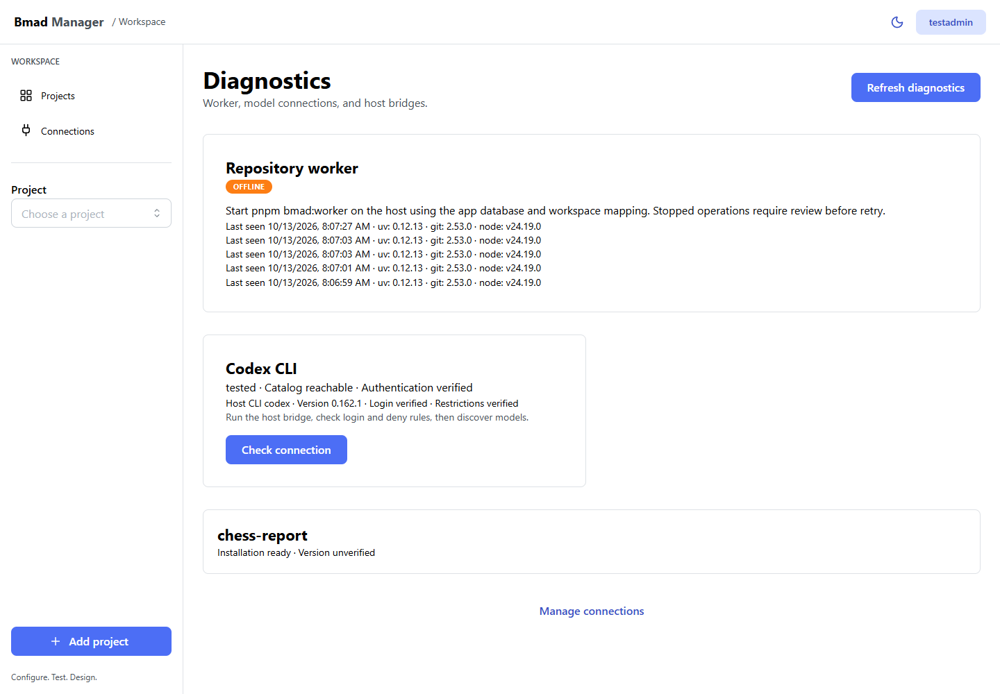
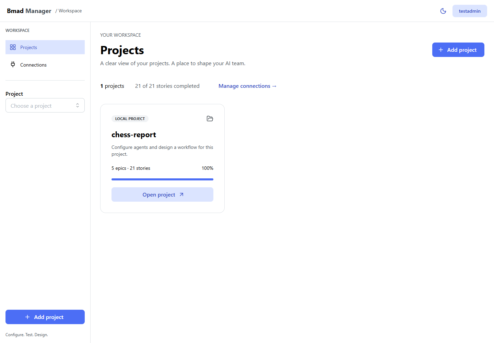
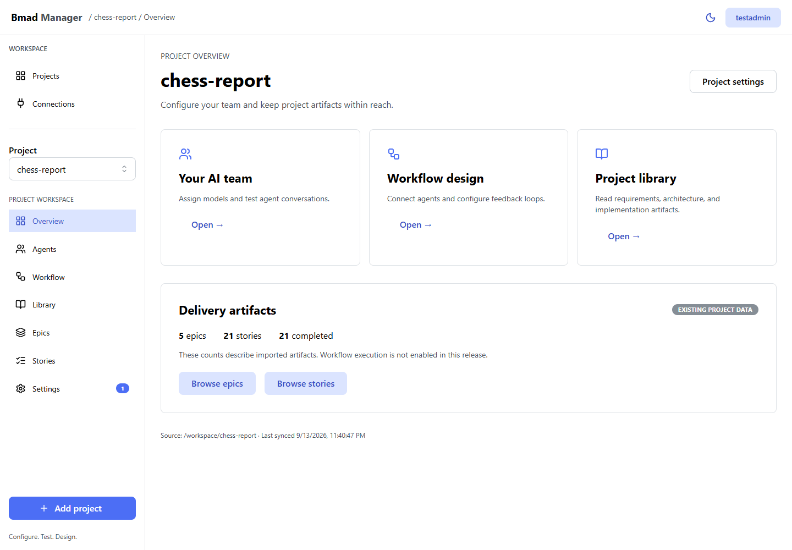
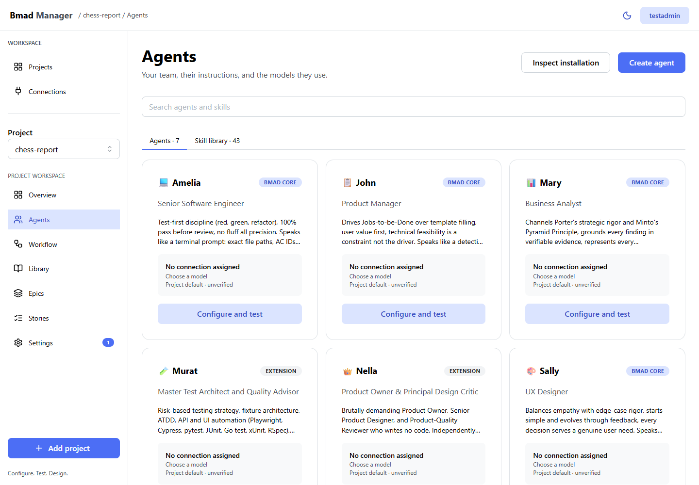
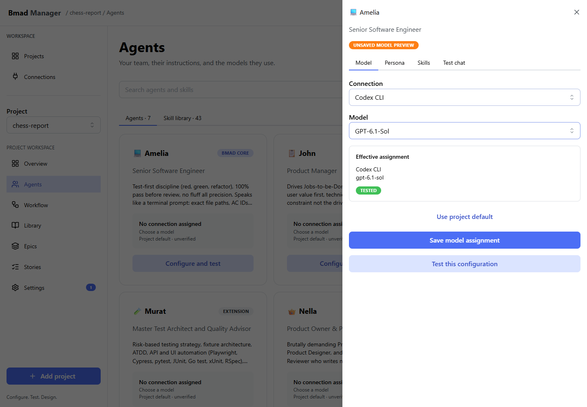
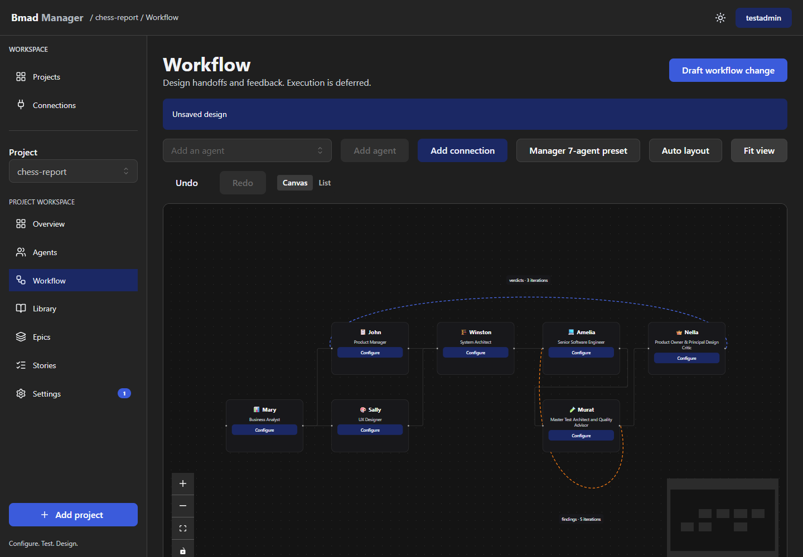
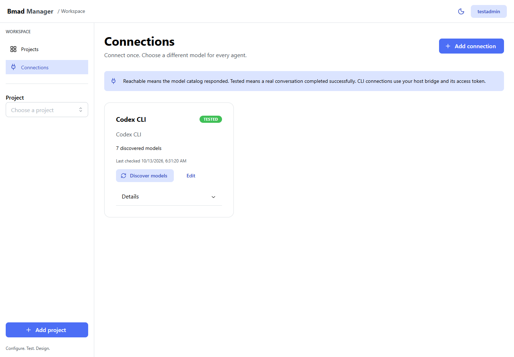
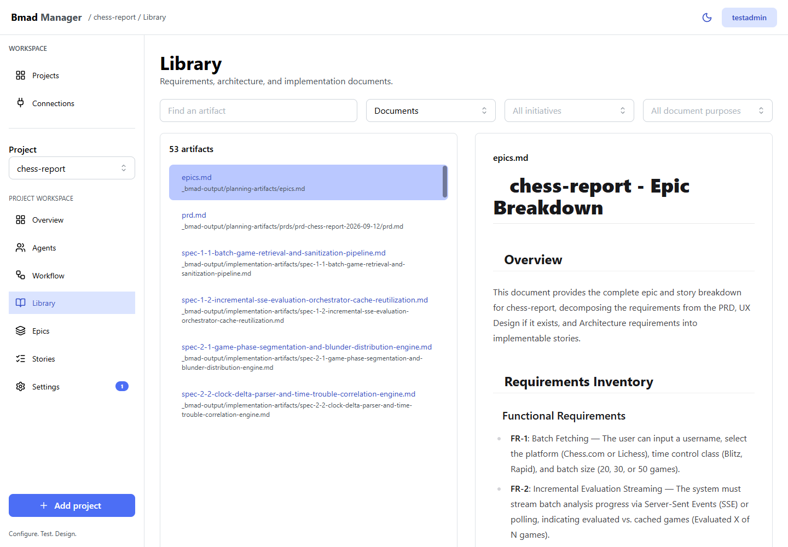
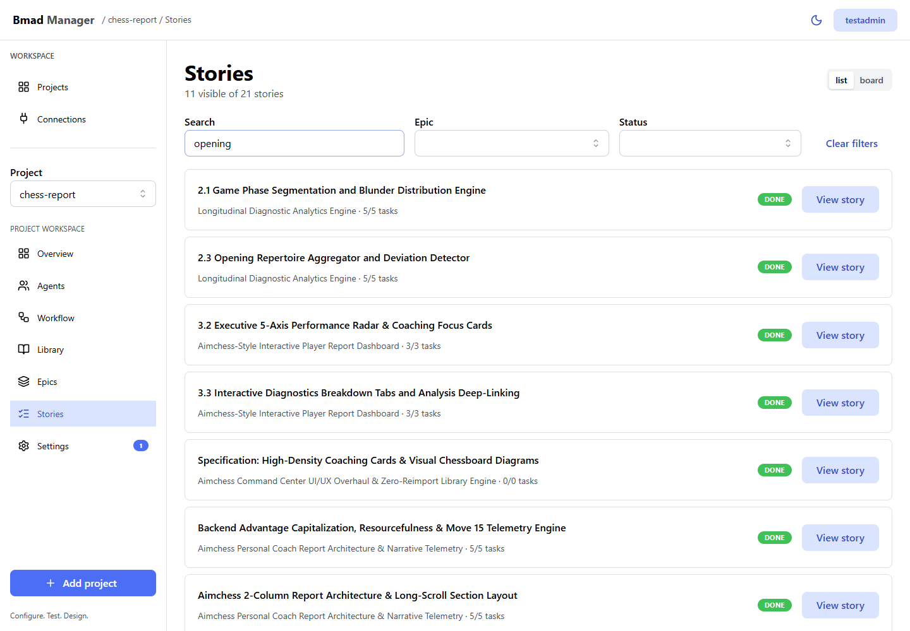
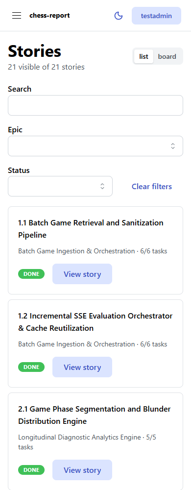

# BMad Manager

A self-hosted workspace for [BMad Method](https://docs.bmad-method.org/) projects. Import a project, configure your AI team, test model conversations, and design handoffs and feedback loops. Read the planning and implementation artifacts alongside the configuration.

Use one workspace to manage agent settings, compare model connections, and browse your project's source artifacts, with light and dark themes and mobile navigation.

## What you can do

- Import an installed local project without reinstalling it, or prepare a reviewed installation for a new folder. Already imported folders offer **Open project**.
- Create reusable, account-owned connections for Ollama, LM Studio, OpenRouter, Codex CLI, AGY, OpenAI, Gemini, and custom compatible endpoints.
- Assign a project default and individual agent overrides using discovered models. Credentials stay with their connection and are encrypted at rest.
- Configure an agent's model, persona, skill, and test chat in the same inspector, including from the workflow canvas.
- Stream test replies using edited settings before saving them; stop a response, retain partial output, and reopen earlier conversations.
- Design a versioned workflow graph with branches and feedback loops, iteration limits, drag positioning, auto-layout, fit-to-view, undo/redo, and an accessible list view.
- Search documents, review epics, and filter stories in a list or board.
- Preview and approve repository changes for a separate worker to apply.

Workflow graphs and iteration limits are **design settings**. Work management integrations, autonomous execution, ticket creation, merges, and releases are deferred.

## BMad compatibility

Agent behavior is edited as separate supported fields with inherited/team/personal previews and reset controls. Approval previews show file changes and reject stale drafts. Workers serialize writes to the same physical project; interrupted work remains quarantined until its worker is stopped and partial files are reviewed.

The app detects stable legacy installs and newer Skills CLI/plugin module records. Stable installation uses the pinned v6.12.0 CLI; v7 setup and updates use the native BMad flow. Unknown profiles are never automatically upgraded. See the [deployment migration guide](docs/reliability-upgrade.md) for existing installations.

Overview guides project setup; Library filters documents by initiative and purpose. Connections distinguish catalog access, authentication, and individual model tests. Diagnostics helps identify unavailable connections and worker prerequisites.



## Explore the workspace

The examples below show project navigation, agent configuration, workflow design, and document browsing.

### Projects and project context

Switch projects without losing the current workspace context. The overview links directly to agents, workflows, source documents, and existing work artifacts.





### Your AI team

Installed capabilities, extensions, and managed agents retain their identities across rescans. Missing capabilities remain unavailable with their history preserved.



Choose a connection and a discovered model in the shared inspector. Model routing is saved to the database immediately; persona and skill changes become repository drafts. **Test chat** previews edited settings without applying them.



### Workflow design

The canvas, list, summaries, and approval preview use the same graph. Feedback loops carry their trigger, payload description, and iteration limit. The Manager seven-agent preset preserves Mary, John, Sally, Winston, Amelia, Murat, and Nella; Nella critiques the experience of a real end user.



The preset is Manager configuration, rather than a claim that every member belongs to the official BMad core roster. Installed BMad metadata remains the source of capability discovery. See [BMad agents and skills](https://docs.bmad-method.org/reference/skills-and-agents/) and [customization](https://docs.bmad-method.org/customize/customize-bmad/).

### Reusable connections

A catalog response proves reachability. A successful test conversation earns **Tested** status. Provider identity, selected model, and latency come from the adapter rather than the model's self-description.



| State | Meaning |
| --- | --- |
| Unverified | Settings saved; no successful verification yet |
| Reachable | The endpoint returned a model catalog |
| Authenticated | Authentication verified by the CLI bridge or successful inference |
| Tested | A real test conversation completed successfully |
| Unavailable | The latest connection check failed |

Codex CLI uses its signed-in host session through a separate [app-server bridge](https://developers.openai.com/codex/app-server/). It is distinct from OpenAI API access. AGY also runs through a host bridge and refuses test requests unless its permission restrictions can be verified. CLI test sessions run outside project repositories with tools disabled.

### Planning files and stories

The library prioritizes planning and implementation documents and supports search and category filters. Stories start in a compact list with visible/total counts and optional board view. Mobile navigation uses a drawer.







## Run locally

Use Node.js 22+, pnpm 11+, PostgreSQL, and Docker Compose. The included Compose file mounts `C:/workspace` for Windows local projects; change that mount and `LOCAL_HOST_WORKSPACE` for your machine.

1. Clone the repository and install dependencies:

   ```bash
   git clone https://github.com/pouyaSamie/Bmad-Manager.git
   cd Bmad-Manager
   pnpm install
   ```

2. Copy `.env.example` to `.env`. Set your database password, `BETTER_AUTH_SECRET`, and a stable 32-byte base64url `AGENT_ENCRYPTION_KEY`. Set `BETTER_AUTH_URL=http://localhost:3002`. Keep the host database URL on `localhost:5433`; Compose supplies the container's internal URL.

3. Start PostgreSQL, apply schema migrations, and create your administrator:

   ```bash
   docker compose up -d postgres
   pnpm prisma migrate deploy
   pnpm db:create-admin --email you@example.com --password "YOUR_PASSWORD" --name Admin
   ```

4. Start the Docker application:

   ```bash
   docker compose up -d --build web
   ```

   Open [localhost:3002](http://localhost:3002). For development, run `pnpm dev` instead of the Docker web service. Use `ALLOW_REGISTRATION=false` after account setup.

5. Run `pnpm bmad:worker` separately on the host when applying approved repository changes. Its database URL and project mapping must point to the same database and folders as the app.

Existing installations also need `pnpm db:migrate-workspace` once. It preserves legacy model routes in separate owner-scoped connections and converts ordered workflows to graphs without writing project files. Read the [workspace upgrade and host bridge guide](docs/workspace-upgrade.md).

## Configure and test a model

1. Open **Connections → Add connection** and choose a provider.
2. Enter the endpoint and credential only when needed, then **Save and discover models**.
3. Open **Project → Agents → Configure and test**, choose the connection and model, and save the model assignment. Project defaults live in **Settings**.
4. Use **Test chat** to try the current model, persona, and skill. A preview does not apply repository customization.

For Codex, set a random `CLI_BRIDGE_TOKEN` of at least 32 characters and run `pnpm codex:gateway` on the signed-in host. Add that token to the Codex CLI connection. The default endpoint in Docker is `http://host.docker.internal:3006/v1`; host applications use `http://localhost:3006/v1`. AGY uses port 3005 and `pnpm agy:gateway`. Bridge networking, restrictions, and optional binary paths are explained in the [bridge guide](docs/workspace-upgrade.md).

Local providers require a running endpoint; cloud providers require credentials. Save a connection, discover its models, and complete a test conversation to check your own configuration. Provider support does not imply that your connection is already authenticated or tested.

## Apply project changes safely

Repository operations follow **draft → preview → approval → queued → worker → applied/failed**. Review the affected agents, files, and changes in **Settings**. A queued operation has not yet been applied.

- Interrupted worker operations require stopping the old worker, checking partial changes, and explicitly releasing the project lock before a new draft can run.
- Team customization is stored in `_bmad/custom/config.toml` plus per-skill behavior overrides. Personal overrides use gitignored `*.user.toml` files.
- Installed vendor skills are protected. A managed copy uses a unique destination and preserves supporting resources.
- Workflow designs are stored in `_bmad/custom/workflow.toml` as Manager configuration.
- **Unlink** removes the dashboard record while preserving files and Git. Full BMad uninstall is a reviewed worker operation that removes BMad assets while preserving source code and Git.

## Development

| Command | Purpose |
| --- | --- |
| `pnpm dev` | Development server on port 3002 |
| `pnpm build` | Production build and type checking |
| `pnpm lint` | ESLint |
| `pnpm test` | Vitest unit suite |
| `pnpm test:journey` | Browser integration tests with isolated project fixtures |
| `pnpm db:generate` | Regenerate Prisma client |
| `pnpm db:migrate` | Create a development migration |
| `pnpm prisma migrate deploy` | Apply production migrations |
| `pnpm db:migrate-workspace` | Convert legacy routes and workflow data |
| `pnpm bmad:worker` | Apply approved repository operations |
| `pnpm codex:gateway` / `pnpm agy:gateway` | Host CLI bridges |

Browser tests cover the import, configuration, conversation, workflow, and approval journeys across desktop and mobile layouts. Generated reports are stored in ignored `.qa-results/`.

Set `QA_BASE_URL`, `QA_EMAIL`, `QA_PASSWORD`, `QA_WORKSPACE`, and `QA_BROWSER` to match your local test environment. Run this only against a development database with access to the same workspace as Docker and the worker. Real Codex testing runs when a connection named **Codex CLI** is configured for that account.

Screenshot maintenance: set `QA_EMAIL`, `QA_PASSWORD`, and `QA_PROJECT_PATH` (for example `/repo/local/my-project`), then run `pnpm exec tsx scripts/capture-readme.ts`. The script captures existing screens without applying project changes.

## Stack and project conventions

| Area | Technology |
| --- | --- |
| Application | Next.js 16, React 19, TypeScript |
| Interface | Mantine, React Flow, Tailwind CSS v4 |
| Data | PostgreSQL 17, Prisma |
| Authentication | Better Auth |
| GitHub access | Octokit |
| Tests | Unit and browser integration tests |
| Deployment | Docker; optional Traefik production setup |

Planning artifacts live in `_bmad-output/planning-artifacts/`; implementation artifacts in `_bmad-output/implementation-artifacts/`. Numeric and alphanumeric epic/story identifiers are supported. Existing document URLs remain valid; legacy Control and Models URLs redirect to Workflow and Settings.

Read [AGENTS.md](AGENTS.md) for contribution conventions, the [API reference](docs/API.md) for health/cache endpoints, and [production deployment](docker/DEPLOY.md) for the hosted stack.

## License

[MIT](LICENSE).
